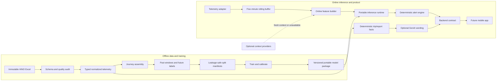
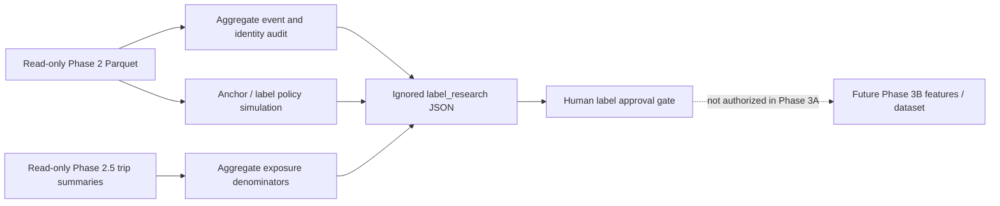
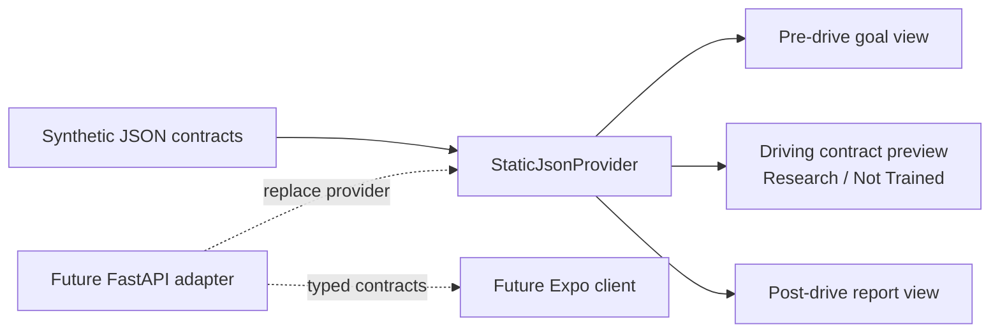
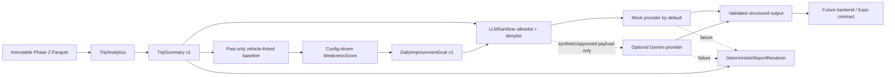
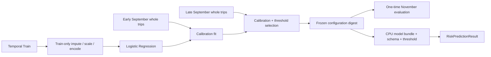

# HINO SafePilot Architecture

## Design principles

- HINO telemetry is the only required source for Model V0.
- Raw/reference inputs are immutable and every transformation is versioned.
- Feature and label computation share explicit event-time semantics.
- Safety decisions are deterministic around a calibrated predictive model; an LLM may explain facts but cannot decide them.
- Offline training may use CUDA; packaged inference must run on CPU and must not depend on a named GPU.

## Overall system



## Offline training pipeline

1. **Source registry**: verify filename, byte size, SHA-256, confidentiality, and allowed Git policy.
2. **Audit**: inspect workbook sheets, schema, source types, official ranges, null patterns, timestamp parseability, journey-key integrity, cadence, and event-slot behavior.
3. **Normalize**: parse strings into typed columns, retain raw-to-normalized mappings, standardize nulls, add quality flags, and never silently clip invalid values.
4. **Journey assembly**: group by `(enabledCode, journeyCode)`, sort by parsed event time, deterministically resolve duplicate timestamps, and produce journey bounds and quality summaries.
5. **Label event table**: unnest event slots; deduplicate an event by at least vehicle, journey, event type, and organizer event start time; separate onset from active/ending states.
6. **Window generation**: build past-only tabular aggregates or masked temporal sequences and future-only labels. Store feature/label version and cutoff convention.
7. **Split manifests**: create immutable journey-level temporal and vehicle holdout assignments before fitting preprocessing.
8. **Training**: fit preprocessing and models only on training partitions; configure `device`, batch size, workers, and precision without GPU-specific code.
9. **Evaluation and calibration**: select calibration and alert thresholds using validation data; evaluate the frozen package once on the designated test set.
10. **Packaging**: save schema, feature order, normalization parameters, calibration, thresholds, alert policy, supported runtime, and model hash together.

Recommended derived layers:

- `data/interim/audit/`: sanitized aggregate audit outputs and schema checks.
- `data/interim/telemetry_normalized/`: typed, partitioned Parquet by time and vehicle hash.
- `data/interim/events/`: deduplicated event-onset table.
- `data/processed/windows/<dataset_version>/`: training examples plus split manifest.

All remain Git-ignored. ETL V0 retains organizer identifiers for provenance and adds a deterministic hashed `trip_id`; its physical partition/compression decisions are recorded below.

## Phase 3A label research boundary



- `hino_safepilot.label_research` is a research package, not a feature builder. It writes aggregate JSON only and has no training dependency.
- Anchors are unique existing telemetry timestamps. The candidate input/label boundary is `[t-300s,t)` → `(t,t+60s]`; incomplete or observation-ambiguous futures never become negatives.
- Raw event fields at `t`, event completion/end/duration, future telemetry, and Phase 2.5 `post_trip_analytics` are architectural forbidden dependencies for online features.
- Private journey/vehicle keys exist only in process memory for grouping. Outputs use counts, rates, and anonymous concentration ranks.
- The recommended candidate contract and unresolved approval gates are in `docs/label_design.md` and ADR 0003.

## Local Demo UI



The `demo/` directory is a localhost results viewer built with static HTML, CSS, and vanilla JavaScript. It is not an official product, does not execute ML logic, and accepts only bundled contracts marked synthetic. The driving probability is visibly labeled `Synthetic Demo` and `Model Status: Research / Not Trained`.

All reads are centralized behind `DataProvider`/`StaticJsonProvider`. A future `ApiProvider` can map versioned FastAPI responses to the same rendering contract. Expo should consume the backend Pydantic/OpenAPI contracts directly rather than embed this DOM renderer. Static samples must never be replaced with HINO-derived data; any separately approved real demo artifact belongs under ignored `data/processed/demo/`.

## Phase 2.5 analytics and report pipeline



- Analytics is local, deterministic, and reads only typed Phase 2 Parquet. It writes ignored artifacts under `data/processed/analytics/` without changing Phase 2 outputs.
- A profile key is a pseudonymous **vehicle-linked behavior profile**, never a `driver_id`. Real personalization waits for application-owned `driver_id -> trip_id` mapping.
- Distance and fuel sum guarded nonnegative increments across valid cumulative observations. Negative increments start a new segment; implausible jumps are rejected, not clipped. Every result carries quality state and warnings.
- Event counts use conservative deduplicated onset candidates. Rates require valid nonzero distance or driving-time exposure. Event 7 remains `decelerate`.
- `post_trip_analytics` is a hard architecture boundary: it may inspect 30 seconds after an event for explanation but must never be imported into future prediction features. At most 20 notable contexts per trip are selected from the ten reviewed Phase 2.5 behavior/safety types using deterministic priority then time; counts remain uncapped.
- Baseline selection requires `trip_end < cutoff_exclusive`. The materialized contracts cover previous 7 days, previous 30 days, and previous 10 trips.
- Weakness selection is outside the LLM. Prototype scoring weights and reference rates are versioned in `config/behavior_goal_v0.json` and remain `UNRESOLVED` pending domain validation.

Physical layout and privacy decisions are recorded in `docs/adr/0002-phase-2-5-analytics-llm-architecture.md`.

## ETL V0 implementation

Phase 2 implements the first three derived layers under `data/interim/` and intentionally stops before windows, labels, or splits.

### Ingestion and safety

- CLI: `python -m hino_safepilot.etl --repo-root .`; `--source`, `--output-root`, `--manifest`, `--batch-size`, and `--dry-run` are configurable.
- The source SHA-256 is loaded from `docs/data_manifest.md`, checked before ingestion and after output generation, and paired with a source mtime/size guard.
- `openpyxl` uses `read_only=True` and `data_only=True`; no workbook save, recalculation, or whole-workbook pandas materialization occurs.
- Ordered source headers, both required sheets, dimensions, row count, and column count are fail-fast contracts.
- The pipeline refuses output outside `data/interim/` or `data/processed/` and refuses to overwrite an existing ETL dataset directory.

### Two-pass bounded-memory flow

1. Pass 1 streams all source rows and builds an on-disk SQLite count index for `(enabledCode, journeyCode, time)`. Only the actual duplicate groups are retained in memory for Pass 2.
2. Pass 2 streams rows again, explicitly parses telemetry, writes batches, unnests all three event slots, and accumulates conservative onset candidates.
3. Every source numeric-like field is represented as `*_raw`, parsed canonical value, and `*_quality`; out-of-range values remain parsed and are not clipped.
4. Duplicate source rows remain in telemetry with source row/hash, group size, duplicate indicator, and whether the group's complete raw rows are identical.
5. Event onset identity uses vehicle, journey, source event type, and valid parsed event start time. Missing/malformed identity is not merged across rows. Payload/end-time variations become conflict flags, while every observation remains in `events_observed`.

### Parquet layout and compression

```text
data/interim/
  audit/
    etl_run_manifest.json
    quality_summary.json
    schema_snapshot.json
  telemetry_normalized/year_month=YYYY-MM/part-00000.parquet
  events_observed/year_month=YYYY-MM/part-00000.parquet
  events_onsets/year_month=YYYY-MM/part-00000.parquet
```

- `year_month` is derived from the parsed telemetry timestamp for telemetry and event observations, and from event start time for onset candidates with telemetry-time fallback when start is unparseable.
- Timestamp columns are Arrow `timestamp[s]` with no timezone. Source strings remain alongside them; timezone semantics remain `UNRESOLVED` and no conversion occurs.
- One writer per observed month per dataset avoids per-trip/per-vehicle tiny files while keeping month pruning simple.
- Default compression is ZSTD level 3 with dictionary encoding and statistics. It was selected over Snappy for the private, offline/interim workload because read/write latency is not the only concern and the moderate dataset benefits from smaller durable artifacts.
- Decision rationale is recorded in `docs/adr/0001-etl-v0-parquet-layout.md`.

### Actual Phase 2 output

- `telemetry_normalized`: 493,744 rows, 76 columns, 8 Parquet files, 45,434,410 bytes.
- `events_observed`: 111,172 rows, 52 columns, 8 Parquet files, 7,984,375 bytes.
- `events_onsets`: 86,789 rows, 28 columns, 10 Parquet files, 7,575,222 bytes.
- The syntactically valid source event time in year 1970 is preserved and produces one onset partition under `year_month=1970-01`; its meaning is `UNRESOLVED`, not normalized away.
- Semantic determinism covers schemas, row/event/onset counts, quality aggregates, candidate IDs, and conflict flags. Byte-identical Parquet and run timestamps are explicitly not claimed.

## Online inference pipeline

The runtime contract mirrors training transformations:

1. Validate and timestamp incoming HINO telemetry.
2. Place observations in a per-vehicle event-time buffer; reject or flag late/out-of-order records according to a reviewed lateness policy.
3. Build the same feature schema used offline, including missingness masks and elapsed-time features for irregular samples.
4. If minimum history/quality requirements are met, run the packaged CPU-capable model; otherwise emit `insufficient_history` or `degraded_input` without fabricating risk.
5. Apply calibration, frozen thresholds, and alert-engine state.
6. Return risk, model version, data-quality state, and alert decision. Raw private rows should not be emitted to logs.

The online feature builder should be implemented from a shared feature specification with offline parity tests, not duplicated ad hoc code.

## Alert engine

The alert engine is a deterministic state machine outside the ML model:

- threshold crossing or class-specific thresholds;
- minimum confidence/calibration version checks;
- deduplication of repeated predictions for the same anticipated event;
- per-class cooldown and global false-alert budget;
- hysteresis to prevent rapid on/off toggling;
- optional escalation only after sustained risk or compatible compound signals;
- suppression or downgrade when telemetry quality is insufficient;
- an auditable reason code for every alert or suppression.

Thresholds must be selected against event-level recall, false alerts per driving hour, and warning lead time. The desired operating point and warning UX are `UNRESOLVED`.

## GenAI layer

Phase 2.5 implements GenAI only as an optional presentation layer over a typed, deterministic fact payload. It may:

- phrase a pre-trip improvement goal selected by rules;
- summarize reviewed trip metrics;
- explain model-independent coaching recommendations;
- format a narrative report.

It must not compute labels, driving scores, alert thresholds, risk, savings, or safety decisions. `LLMSanitizer` reconstructs an allowlisted aggregate payload and fails closed on identifiers, source-row keys, or precise coordinates. `MockLLMProvider` is the default. `GeminiLLMProvider` lazily uses the official `google-genai` SDK, environment-selected model, Pydantic structured output, and no raw telemetry. Bounded retry is followed by `DeterministicReportRenderer`; invalid output never reaches UI. Real HINO-derived external calls remain prohibited pending human approval.

## External context provider abstraction

Define a provider interface that returns typed context plus `observed_at`, `valid_until`, location coverage, provenance, and availability status. Provider failures return an explicit unavailable result. Model V0 does not call providers.

Model V1 training may use an external variable only after historical data can be joined to telemetry at the same time and place without future information. Live-only APIs are not valid historical training sources. Offline materialization prevents external APIs from becoming ETL hard dependencies.

## Graceful degradation

| Failure | Required behavior |
|---|---|
| External context unavailable | Continue HINO-only path; mark context unavailable. |
| CAN invalid/missing | Use an explicitly trained reduced feature set or suppress prediction; never impute an unverified normal state. |
| GPS invalid/missing | Disable location/speed-limit-derived features and expose degraded quality. |
| Insufficient five-minute history | Return insufficient history; do not overstate confidence. |
| Model/package incompatibility | Fail closed for warnings and retain deterministic telemetry summaries. |
| Backend/network unavailable | Local demo behavior is `UNRESOLVED`; no dependency on the offline-training GPU is permitted. |
| GenAI unavailable | Use deterministic templates and preserve all core functions. |

## Phase 3B-1 dataset boundary

The HINO-only offline dataset path is:

`Phase 2 Parquet -> eligibility/anchor builder -> past-only feature engine -> future-onset label engine -> whole-trip split/embargo -> physical feature/metadata separation -> audits -> v0_hino Parquet`

The feature engine is independent of Phase 2.5 analytics and never imports post-trip event context. It reads only Phase 2 normalized telemetry/events/onsets and the Phase 3A eligibility contract. Feature-source availability timestamps and label-onset timestamps are retained in private audit metadata so automated checks can prove `[feature source < anchor < positive onset <= anchor+60s]`.

Dataset tables are partitioned into one ZSTD Parquet file per temporal split; private metadata mirrors the split in separate files. The deterministic `anchor_id` exists in both only as a linkage key and is excluded from `feature_columns`. Audit evidence and split/holdout manifests are separate. This avoids tiny files, permits model loaders to select an identifier-free feature matrix, and keeps grouped evaluation possible.

## External context-ready boundary

`src/hino_safepilot/context/` defines typed traffic, weather, and disaster snapshots plus provider protocols and a `ContextAggregator`. Availability is explicit (`available`, `missing`, `stale`, `error`, `unsupported`). Phase 3B-1 implements only Null and Synthetic providers; there is no networking code.

Future context must be independently materialized with provenance and joined using event-time/as-of rules that never expose observations published after an anchor. Context absence must preserve HINO-only inference. Dataset versions (`v0_hino`, `v1_hino_traffic`, `v2_hino_traffic_weather`, `v3_full_context`) remain distinct so every context increment can be evaluated by ablation.

Road-event relevance is a future deterministic service considering distance, heading, same-road evidence, ahead/behind direction, route relationship, and estimated time to event. A Euclidean radius alone is not sufficient, and Google Routes is optional future scope only.

## Phase 3C-1 model and evaluation boundary



The model package contains the fitted ColumnTransformer/Logistic pipeline, selected calibration object, exact feature order, model/threshold versions, and prototype operating points. `RiskPredictionResult` exposes one any-risk probability, a 60-second horizon, data-quality status, and experimental UI level; it does not assert an event class.

Test access is one-way per experiment version. Preprocessing, model, calibration, and threshold scopes are recorded as digests before Test is loaded. Any post-Test model/threshold change requires a new experiment ID and cannot overwrite this report.

Alert episodes remain outside label truth. The current 60-second cooldown collapses predictions only for an explicitly experimental evaluation, while the future alert engine still requires a human-approved alert budget, episode matching, hysteresis, and driving-exposure definition.

## Phase 3C-2 nonlinear model and alert boundary

`XGBRiskModelBundle` packages a target-blind XGBoost preprocessor, Booster, calibrator, exact raw feature order, model/calibration versions, and global association-only factors. Training prefers CUDA but probes it at runtime and falls back to CPU; inference has no laboratory-GPU dependency.

Selection uses three expanding pre-November folds. Early September is calibration-only and late September is policy development. Event scans use trip/time predicate pushdown so November features and labels remain unopened until a frozen digest exists. November is then read once and labeled `KNOWN_HOLDOUT COMPARATIVE BENCHMARK`.

`RiskPredictionResult` and `AlertDecision` are deliberately separate. The risk model never owns cooldown or speech state. `AlertPolicyEngine` is a deterministic per-trip state machine with new-episode, one-escalation, hysteresis-reset, and no-repeat semantics. Alert evaluation matches events one-to-one and never changes Label V0.
