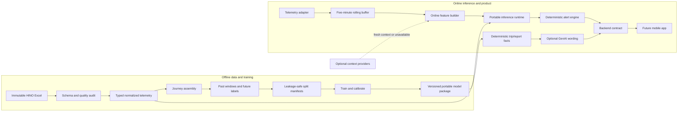

# HINO SafePilot Architecture

## Design principles

- HINO telemetry is the only required source for Model V0.
- Raw/reference inputs are immutable and every transformation is versioned.
- Feature and label computation share explicit event-time semantics.
- Safety decisions are deterministic around a calibrated predictive model; an LLM may explain facts but cannot decide them.
- Offline training may use CUDA; packaged inference must run on CPU and must not depend on a named GPU.

## Overall system

## Offline training pipeline

1. **Source registry**: verify filename, byte size, SHA-256, confidentiality, and allowed Git policy.
2. **Audit**: inspect workbook sheets, schema, source types, official ranges, null patterns, timestamp parseability, journey-key integrity, cadence, and event-slot behavior.
3. **Normalize**: parse strings into typed columns, retain raw-to-normalized mappings, standardize nulls, add quality flags, and never silently clip invalid values.
4. **Journey assembly**: group by `(enabledCode, journeyCode)`, sort by parsed event time, deterministically resolve duplicate timestamps, and produce journey bounds and quality summaries.
5. **Label event table**: unnest event slots; deduplicate an event by at least vehicle, journey, event type, and organizer event start time; separate onset from active/ending states.
6. **Window generation**: build past-only tabular aggregates or masked temporal sequences and future-only labels. Store feature/label version and cutoff convention.
7. **Split manifests**: create immutable journey-level temporal and vehicle holdout assignments before fitting preprocessing.
8. **Training**: fit preprocessing and models only on training partitions; configure `device`, batch size, workers, and precision without GPU-specific code.
9. **Evaluation and calibration**: select calibration and alert thresholds using validation data; evaluate the frozen package once on the designated test set.
10. **Packaging**: save schema, feature order, normalization parameters, calibration, thresholds, alert policy, supported runtime, and model hash together.

Recommended derived layers:

- `data/interim/audit/`: sanitized aggregate audit outputs and schema checks.
- `data/interim/telemetry_normalized/`: typed, partitioned Parquet by time and vehicle hash.
- `data/interim/events/`: deduplicated event-onset table.
- `data/processed/windows/<dataset_version>/`: training examples plus split manifest.

All remain Git-ignored. Exact partition granularity and whether identifiers are hashed are `UNRESOLVED` pending team workflow and privacy review.

## Online inference pipeline

The runtime contract mirrors training transformations:

1. Validate and timestamp incoming HINO telemetry.
2. Place observations in a per-vehicle event-time buffer; reject or flag late/out-of-order records according to a reviewed lateness policy.
3. Build the same feature schema used offline, including missingness masks and elapsed-time features for irregular samples.
4. If minimum history/quality requirements are met, run the packaged CPU-capable model; otherwise emit `insufficient_history` or `degraded_input` without fabricating risk.
5. Apply calibration, frozen thresholds, and alert-engine state.
6. Return risk, model version, data-quality state, and alert decision. Raw private rows should not be emitted to logs.

The online feature builder should be implemented from a shared feature specification with offline parity tests, not duplicated ad hoc code.

## Alert engine

The alert engine is a deterministic state machine outside the ML model:

- threshold crossing or class-specific thresholds;
- minimum confidence/calibration version checks;
- deduplication of repeated predictions for the same anticipated event;
- per-class cooldown and global false-alert budget;
- hysteresis to prevent rapid on/off toggling;
- optional escalation only after sustained risk or compatible compound signals;
- suppression or downgrade when telemetry quality is insufficient;
- an auditable reason code for every alert or suppression.

Thresholds must be selected against event-level recall, false alerts per driving hour, and warning lead time. The desired operating point and warning UX are `UNRESOLVED`.

## GenAI layer

GenAI is a future presentation layer over a typed, deterministic fact payload. It may:

- phrase a pre-trip improvement goal selected by rules;
- summarize reviewed trip metrics;
- explain model-independent coaching recommendations;
- format a narrative report.

It must not compute labels, driving scores, alert thresholds, risk, savings, or safety decisions. Its output is optional, attributable, and replaceable with templates. Failure falls back to deterministic copy.

## External context provider abstraction

Define a provider interface that returns typed context plus `observed_at`, `valid_until`, location coverage, provenance, and availability status. Provider failures return an explicit unavailable result. Model V0 does not call providers.

Model V1 training may use an external variable only after historical data can be joined to telemetry at the same time and place without future information. Live-only APIs are not valid historical training sources. Offline materialization prevents external APIs from becoming ETL hard dependencies.

## Graceful degradation

| Failure | Required behavior |
|---|---|
| External context unavailable | Continue HINO-only path; mark context unavailable. |
| CAN invalid/missing | Use an explicitly trained reduced feature set or suppress prediction; never impute an unverified normal state. |
| GPS invalid/missing | Disable location/speed-limit-derived features and expose degraded quality. |
| Insufficient five-minute history | Return insufficient history; do not overstate confidence. |
| Model/package incompatibility | Fail closed for warnings and retain deterministic telemetry summaries. |
| Backend/network unavailable | Local demo behavior is `UNRESOLVED`; no dependency on the offline-training GPU is permitted. |
| GenAI unavailable | Use deterministic templates and preserve all core functions. |

