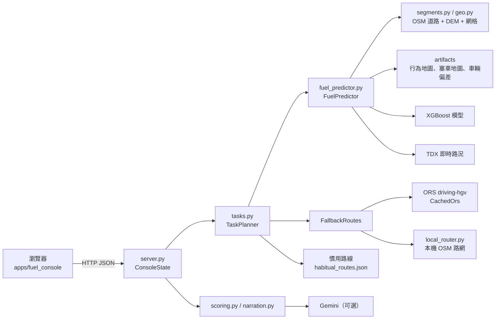

# 油耗預測與發派主控台：交接說明

給接手開發的人。模型的輸入、輸出、訓練方式與每個數值的意思見 `docs/fuel_model_explained.md`；演算法細節與實驗數字見 `docs/fuel_system.md`；需求來源是 `docs/開發說明書.md`。

## 1. 這個網站在做什麼

本機網頁工具（`hino-fuel serve` → http://127.0.0.1:8765），用 HINO 車隊真實遙測資料訓練的模型做三件事：

1. **發派預測**：給一個圍籬任務（起點 → 中途停靠 → 終點、出發時間），選車系後，比較該車系的駕駛 × 車輛組合（每台車只配一位駕駛）的整趟預測油耗，建議派最省油的那組。
2. **回測**：用測試期真實行程檢查預測準不準。
3. **油耗分數與報告**：每趟真實行程的油耗分數，以及一段給司機看的文字報告。

所有數字由確定性程式與 XGBoost 計算。LLM（Gemini，可選）只負責把算好的 JSON 寫成中文，不參與任何數字或決策。

整個系統只用免費服務：OpenRouteService（ORS）規劃路線、TDX 即時路況、OpenStreetMap 路網與內政部 DEM。不使用 Google Routes。

## 2. 快速開始

```powershell
python -m venv .venv
.\.venv\Scripts\python.exe -m pip install -e ".[dev,fuel,ai]"
Copy-Item .env.example .env      # 再填入金鑰（見下表）
```

`.env`（git-ignored，不可提交）：

| 變數 | 用途 | 沒有時 |
|---|---|---|
| `ORS_API_KEY` | ORS 路線規劃、圍籬命名 | 改用本機路網（需先 `build-graph`） |
| `TDX_CLIENT_ID`、`TDX_CLIENT_SECRET` | TDX 即時路況 | 只能用歷史塞車地圖 |
| `GEMINI_API_KEY`、`GEMINI_MODEL` | 報告文字 | 用固定範本文字 |
| `LLM_PROVIDER` | `none` 強制關閉 LLM；`auto`/`mock` 有金鑰就用 Gemini | |

需要的外部資料（皆 git-ignored，取得方式見 `docs/fuel_system.md`）：主辦方遙測原始資料、`data/osm/taiwan-latest.osm.pbf`、`data/dem/moi_dem20m/不分幅_全台及澎湖DEM/dem_20m.tif`。

第一次從頭建置（依序執行，每步產出供下一步使用）：

```powershell
hino-etl --repo-root .     # 原始資料 -> data/interim（Phase 2 ETL）
hino-fuel segments         # 切成 3/5/10 km 路段
hino-fuel train            # 健康度、對照表、XGBoost 模型 -> models/fuel/v1
hino-fuel drivers          # 虛擬駕駛名單、行程分配、每人各道路的行為平均（不重新訓練模型）
hino-fuel score            # 測試期油耗分數
hino-fuel backtest         # 真實行程回測 + 派車校正（會呼叫 ORS，回應有快取）
hino-fuel route-overlap    # 回測行程是否照規劃路線開
hino-fuel fences           # 資料圍籬、慣用路線、停靠怠速模型
hino-fuel fence-test       # 圍籬對圍籬測試（會呼叫 ORS）
hino-fuel build-graph      # 本機 OSM 路網（ORS 備援）
hino-fuel serve            # 開啟主控台
```

已有產出時只需要 `hino-fuel serve`。改了 Python 程式要重啟 server；只改前端（`apps/fuel_console/`）重新整理瀏覽器即可。

## 3. 架構



一次發派預測的流程（`POST /api/task`）：

1. `server.py` 驗證輸入，把車輛代號 V01… 換回內部 enabledCode。
2. `TaskPlanner` 對每一段（站 i → 站 i+1）找候選路線：ORS 1–3 條、車隊熟悉路線（本機路網，偏好車隊常跑的網格）、慣用路線（兩端都是資料圍籬且訓練期有固定走法）。ORS 失敗時自動改用本機路網。
3. `FuelPredictor.describe_route` 把每條候選路線切成 3 km 段，查道路類型、坡度、網格、時段與塞車程度；`predict_pairs` 一次算完該車系每位駕駛 × 每台車的油耗（預估行為 = 路段一般值 × 駕駛在該種道路的個人平均），再乘派車校正倍率。
4. 每段採用「所有組合平均油耗最低」的候選路線；時鐘依序推進（行車時間 + 停留時間），下一段用新的時段。
5. 加上停靠怠速油耗，依油耗由低到高挑組合，每台車、每位駕駛最多出現一次（`match_unique`）。第一名為建議派、最後一名為最耗油。

只有一個油耗模型（`models/fuel/v1/`），用真實路段的實際行為訓練，不看駕駛身分；發派、分數、回測都用它。新增駕駛不必重新訓練。

## 4. 各分頁怎麼用、怎麼看

### 發派預測

* **示範任務**：4 個預設任務（`config/fuel_demo_fences.json`），選了會自動帶入停靠點、停留時間與出發時間。
* **停靠點**：起點、中途停靠（0–6 個）、終點都必須是圍籬。可用下拉選單或點地圖圓圈（粉紅＝示範圍籬，紫＝資料圍籬）。中途停靠可設停留分鐘（0–480）。
* **時間**：只支援「指定出發時間」（日期 + 出發時間）。勾「現在出發，使用 TDX 即時路況」時忽略日期與出發時間，以現在為出發時間；即時路況只用在第一段，後面幾段到達時路況已變，改用歷史塞車地圖。
* **車系**：按 300 / 500 / 700 系按鈕就直接開始比較，不需要另外選車或選駕駛。系統會拿該車系的所有駕駛 × 所有車來比，只在同車系內比較，所以不會出現「小車永遠最省」。結果中每台車只配一位駕駛：先取全部組合中最省的一組，再從剩下的人和車取下一組，依此類推，所以列數等於該車系的車數。

結果：

* 建議派：最省油的駕駛、車牌、車系、預測油耗。下面一行是起訖、里程、出發與預計抵達時間，以及最耗油的駕駛和多用的公升數。
* 駕駛排名表：只有排名、車牌、系列、駕駛、預測油耗四項，標示「最省」與「最耗」。
* 地圖只畫採用的路線；顏色表示道路類型（藍高速/快速、綠一般道路、橘市區）。
* 改了起點、終點、停靠或停留時間，舊結果會清掉，再按一次車系即可。
* 預測區間、各段油耗、候選路線比較等細節仍在 API 回應裡，只是不顯示在畫面上。
* 黃色提示框（notes）：例如 ORS 額度用完改用本機路網、即時路況不適用等。

### 真實行程回測

* **圍籬對圍籬測試**：測試期從某個資料圍籬開到另一個資料圍籬的行程，用規劃路線預測後和實際油耗比較。點一組可看每趟明細與地圖路線。
* **真實行程回測（任意起訖點）**：校正前後的 MAPE、偏差、區間涵蓋率，以及「司機有沒有照規劃路線開」的分組。點一趟可在地圖看 ORS 路線。
* 看真實行程時地圖底圖會自動關閉，避免把真實地點範圍送到公開圖磚伺服器。底圖開關在「發派預測」分頁地圖下方；示範圍籬是公開地點，可以開。

### 油耗分數與報告

* 分數 = 75 + (1 − 實際油耗 ÷ 應有油耗) × 100。應有油耗＝同車、同路線、同時段、實際塞車下 normal 駕駛的預測，所以路況與坡度不算在司機身上。
* 點一趟產生報告：Gemini 文字（或固定範本）、對照範本、逐段實際 vs 應有、交給 LLM 的 JSON。Gemini 回覆若出現 JSON 沒有的數字、英文欄位名或超過 220 字，會被拒絕並改用範本。

「駕駛（模擬）」欄是這趟行程分配到的虛擬駕駛。

### 虛擬駕駛（此為模擬資料）

資料沒有駕駛身分，所以系統自建駕駛名單，再把真實行程分給他們。程式在 `drivers.py`，由 `hino-fuel drivers` 產生（要在 `train` 之後跑）。

* **名單**：預設 40 人（300 系 20、500 系 10、700 系 10），設定在 `config/fuel_v1.json` 的 `drivers`。每人屬於一個車系、平常開其中一台車（每台車 2 人）、有設定風格（只用來產生模擬分配）；每個車系有 1 位「新進駕駛」，測試期才開始出車。沒有班表。車牌是模擬車牌（`SIM-3001` 這種格式，不是真實車牌）。
* **分配**：每個真實「車-日」（一台車的一天）分給同車系的一位駕駛。當天行為（怠速、急加速、急減速、超速相對於同樣路段、時段的一般值）在同車系裡的排名越接近駕駛的設定風格，分到的機率越高；平常開這台車的駕駛優先。一人一天只開一台車。
* **個人平均**：駕駛在高速 / 一般道路 / 市區各自的四項行為 ÷ 同樣路段、同時段的一般值。用比值不用次數，因為次數會受路線影響（常跑塞車市區的人怠速本來就多，不代表他開得差）。只用「當天以前」的資料。某種道路開得少時，往他自己的全路段平均收縮。
* **新進駕駛**：沒有紀錄時用一般值；有幾趟之後，先找行為最像他的 3 位資深駕駛，以他們的平均為主，自己的紀錄越多權重越高（w = 趟數 ÷ (趟數 + 10)）。
* **模型**：不另外訓練。油耗模型本來就用真實行為訓練，發派時「預估行為 = 路段一般值 × 個人平均」。人數增加時只要更新個人平均，模型不變。

分頁內容：

* 名單與高速 / 一般 / 市區的個人平均（每格：怠速 / 急加速 / 急減速 / 超速）、相似駕駛、本人權重。
* 測試期 MAPE 比較：不知道是誰開、用駕駛個人平均；分資深駕駛、新進駕駛（依出這趟前已累積的趟數）。
* 新進駕駛學習曲線：只看前 K 趟建立倍率，預測之後行程的誤差。
* 模擬派車重播：測試期每趟換成當天沒出車的同車系駕駛，模型估計能省多少油。

解讀時要注意：

* 分配方式是依行為設計的模擬情境，同一位駕駛本來就被設計成風格一致，所以「知道是誰開」的改善是模擬結果，不是真實車隊的證據。
* 測試期結果（≥10 km，275 趟）：整趟 MAPE 不知道是誰開 11.8%、用個人平均 11.9%，準確度相同。
* 駕駛行為對油耗的影響小：700 系示範任務（龜山→臺中港，幾乎全程高速）同一台車換 10 位駕駛只差 34.0–36.0 L；差距主要來自車（同一位駕駛開 5 台車是 33.8–51.2 L）。
* 駕駛排序的等級相關 0.21：模型預估「誰比較省」和實際結果只有弱相關。派車重播估計可省 3.6% 只是模型推算。

### 模型驗證

段長比較、測試期 MAPE、排序正確率、路線切分結果、特徵重要度、駕駛類型倍率、每台車健康度與效率偏差。數字來自 `reports/fuel/checkpoint3_model.json`（v1），重跑 `hino-fuel train` 才會變。

## 5. API

全部為 JSON。錯誤回 `{"error": "..."}`：400 輸入錯誤、502 外部服務錯誤、500 其他。POST 本文上限 64 KB。

| 方法 | 路徑 | 說明 |
|---|---|---|
| GET | `/api/meta` | 模型資訊、車輛、車系清單、虛擬駕駛摘要、駕駛類型、LLM 狀態、驗證報告 |
| GET | `/api/drivers` | 虛擬駕駛名單與個人平均、`drivers_eval.json` 評估報告 |
| GET | `/api/fences` | `fences`（全部圍籬）、`demo_tasks`（示範任務） |
| POST | `/api/task` | 圍籬任務發派預測 |
| GET | `/api/backtest` | 回測摘要與每趟路線 |
| GET | `/api/fence_test` | 圍籬對圍籬測試結果 |
| GET | `/api/scores` | 測試期每趟分數 |
| POST | `/api/report` | `{"trip_id": "..."}` → 單趟報告 |

`POST /api/task` 請求：

```json
{
  "date": "2026-10-05",
  "depart_time": "08:30",
  "stops": [
    {"fence_id": "D03"},
    {"fence_id": "D05", "dwell_min": 30},
    {"fence_id": "D04"}
  ],
  "vehicle_type": 300,
  "live": false
}
```

* `stops` 2–8 個，相鄰兩站不能是同一個圍籬。`dwell_min` 只對中途停靠有效（預設 20）。
* `depart_time` 為 `HH:MM` 或 ISO 時間；`live=false` 時必填。`live=true` 且沒給時間就是現在出發。
* `vehicle_type`（車系）必填。系統比較該車系所有駕駛 × 所有車，回傳時每台車、每位駕駛最多一次；`drivers` 可選，用來縮小名單（必須同車系）。
* 尚未執行 `hino-fuel drivers` 時，改用五種駕駛類型 × 該車系所有車（`driver_types`）。

回應主要欄位：

| 欄位 | 內容 |
|---|---|
| `depart_time`、`arrive_time`、`total_minutes`、`distance_km` | 整趟摘要 |
| `stops[]` | `fence_id`、`name`、`lon`、`lat`、`radius_m`、`arrive`、`dwell_min`、`depart` |
| `legs[]` | `from`、`to`、`chosen_route_id`、`candidates[]`（`route_id`、`distance_km`、`minutes`、`mean_fuel_L`、`segments[]`、`segment_geometry`） |
| `legs[].candidates[].segments[]` | `km`、`road_band`、`avg_slope`、`congestion_index`、`congestion_source`（`tdx_live` / 歷史）、`time_band`、`predicted_minutes` |
| `pairs_compared` | 比較過的駕駛 × 車組合數 |
| `options[]` | 每台車一列（一位駕駛）：`driver_id`、`driver_name`、`vehicle_id`（車輛代號）、`plate`（模擬車牌）、`vehicle_type`、`predicted_fuel_L`、`prediction_interval_L`、`leg_fuel_L[]`、`stop_idle_fuel_L`（依油耗由低到高） |
| `lowest_fuel_option`、`highest_fuel_option` | 最省（建議派）與最耗的那一列 |
| `notes[]`、`driver_note` | 給使用者看的說明 |

## 6. 檔案在哪裡

追蹤在 Git 的：

| 路徑 | 內容 |
|---|---|
| `apps/fuel_console/` | 前端：`index.html`、`app.js`（純 JS、無建置步驟）、`styles.css`；Leaflet 1.9.4 由 unpkg 載入並有 SRI |
| `src/hino_safepilot/fuel/` | 後端與模型程式（模組對照見下表） |
| `config/fuel_v1.json` | 所有參數：段長、時段、OSM/DEM 路徑、模型候選、ORS/TDX 設定 |
| `config/fuel_demo_fences.json` | 12 個示範圍籬與 4 個示範任務（此為模擬資料，公開地點） |
| `tests/test_fuel_segments.py`、`tests/test_fuel_system.py` | 測試（只用合成資料） |

| 模組 | 負責 |
|---|---|
| `server.py` | HTTP server 與 API；車輛代號轉換 |
| `tasks.py` | 多點任務規劃（`Stop`、`TaskPlanner`） |
| `fuel_predictor.py` | 路線 → 路段特徵 → 油耗；派車校正 |
| `routing.py` | ORS、TDX 客戶端（節流、429 重試、額度用完暫停 15 分鐘） |
| `local_router.py` | 本機 OSM 路網 Dijkstra、`FallbackRoutes` |
| `fences.py` | 圍籬、資料圍籬建立、慣用路線 |
| `segments.py`、`geo.py` | 路徑描述：OSM 道路類型、DEM 坡度、網格 |
| `maps.py`、`artifacts.py`、`vehicles.py` | 行為地圖、塞車地圖、駕駛類型、車輛健康度與效率偏差 |
| `drivers.py` | 虛擬駕駛名單、模擬車牌、車-日分配、各道路的個人平均（只用過去資料）、相似駕駛收縮、一車一人配對 |
| `model.py` | XGBoost 訓練與驗證 |
| `scoring.py`、`narration.py` | 分數、報告 JSON、Gemini/範本文字 |
| `backtest.py` | 回測、校正、路線重疊、停靠怠速模型 |
| `pipeline.py`、`cli.py` | `hino-fuel` 各階段 |

只在本機、不可提交（已 git-ignored）：

| 路徑 | 內容 |
|---|---|
| `models/fuel/v1/` | 模型與 `model_meta.json` |
| `data/processed/fuel/artifacts/virtual_drivers.json`、`driver_profiles.json`、`mock_plates.json` | 虛擬駕駛名單、目前各道路的個人平均與相似駕駛、模擬車牌（此為模擬資料） |
| `data/processed/fuel/driver_assignment.parquet`、`driver_profiles_daily.parquet` | 每個車-日分給哪位駕駛、每天的個人平均 |
| `reports/fuel/drivers_eval.json` | 虛擬駕駛評估報告 |
| `data/processed/fuel/artifacts/` | 對照表、`dispatch_calibration.json`、`stop_idle.json`、`vehicles.parquet` |
| `data/processed/fuel/` | `fences_derived.json`、`habitual_routes.json`、`vehicle_aliases.json`、回測結果、ORS 快取 |
| `reports/fuel/` | 檢查點與驗證報告 |
| `data/osm/`、`data/dem/` | OSM 與 DEM 原始檔、`road_graph_v1.npz` |
| `.env` | 金鑰 |

## 7. 要擴充時從哪裡改

| 想做的事 | 改哪裡 |
|---|---|
| 新增示範圍籬或示範任務 | `config/fuel_demo_fences.json`（`depart` 為 `HH:MM`，`dwell_min` 以圍籬 ID 為鍵） |
| 新增候選路線來源 | `TaskPlanner.leg_candidates`；回傳 `CandidateRoute(route_id, lonlat, ...)` 即可被評估 |
| 換路線服務 | 實作 `routes(key, origin, destination, avoid_tollways=False)` 的物件，傳給 `TaskPlanner` |
| 新 API | `ConsoleState` 加方法，再登記到 `make_handler` 的 `do_GET` / `do_POST` 路由表 |
| 新分頁 | `index.html` 加 `<section id="tab-xxx">` 與 nav 按鈕；`app.js` 的 `switchTab` 加載入函式 |
| 調整參數 | `config/fuel_v1.json`；改模型相關參數後要重跑 `train` 以後的步驟 |
| 換 LLM | `narration.py` 的 `Narrator`；保留數字檢查與範本退回 |

## 8. 尚未完成、建議接手做的事

1. **偏航偵測**：行駛中比對 GPS 與採用路線，偏離時重新預測。誤差主因是「司機沒照規劃路線開」（照開時 MAPE 約 15%，沒照開約 36%）。
2. **真實駕駛身分與車牌**：目前名單、車牌與行程分配都是模擬資料。拿到真實的「誰開哪趟」後，把 `assign_drivers` 換成讀真實排班，其餘（個人平均、相似駕駛、派車）不用改，模型也不用重訓；之後才能驗證「選人」真的省油。
3. **多任務排班**：目前一次只規劃一個任務，不會記錄已派出的駕駛與車；同一天多個任務需要加入占用狀態。
4. **載重資料**：資料中沒有載重；700 系誤差最大，推測與載重有關。有載重欄位就加入特徵。
5. **多點任務的真實驗證**：多點任務功能已完成，但缺少「事先已知停靠清單」的真實資料可以驗證。
6. **部署前的安全措施**：目前沒有登入驗證，只綁定 127.0.0.1。要給多人使用前需加入驗證、HTTPS、權限控管、請求頻率限制，並重新審查哪些資料可以送到瀏覽器（資料圍籬座標是真實場站/客戶位置）。
7. **ORS 額度**：免費方案每分鐘 40 次、每日 2,000 次。目前有快取（`task_ors_cache.json`）與本機路網備援；本機路網沒有大型車限制（限高、限重），正式使用需補上或改自架 ORS。
8. **行動版 App 與後端服務**：`apps/mobile/`、`backend/` 目前只有 README。

## 9. 已知限制

* 不支援「指定抵達時間反推出發時間」，只能指定出發時間。
* 預測區間是 80%（驗證期實際涵蓋約 77%）。
* 即時路況只用在第一段，且出發時間與現在相差超過 30 分鐘就改用歷史地圖。
* 排名的差異主要來自車（效率偏差、健康度），駕駛的影響小；駕駛排名和實際只有弱相關（等級相關 0.21）。
* 沒有班表與占用狀態：系統假設該車系所有駕駛和車都能出車。
* 任務沒列出的停靠與繞路會讓實際油耗高於預測。
* 示範圍籬為公開地點、半徑為假設值（此為模擬資料）。

## 10. 測試

```powershell
.\.venv\Scripts\python.exe -m pytest -p no:cacheprovider -o addopts="" -q
node --check apps\fuel_console\app.js
```

測試只用合成資料，不需要真實遙測、金鑰或網路。外部服務（ORS、TDX、Gemini）在測試中以假物件取代。

手動煙霧測試：開 server 後在「發派預測」依序跑 4 個示範任務，應該都能得到排程與油耗；ORS 額度用完時會出現「改用本機 OpenStreetMap 路網」提示，結果仍會產生。

## 11. 安全與隱私規則（摘自 `AGENTS.md`）

* 遙測資料與主辦方資料是機密：不可修改、搬移、公開或提交原始資料。
* 衍生資料只放 `data/interim/`、`data/processed/`（不進 Git）。
* 不可把真實遙測列、enabledCode、資料圍籬座標寫進文件、測試、log 或範例。瀏覽器只會看到 V01… 代號。
* 金鑰只放 `.env`；`.env.example` 只留空白欄位。
* 安全相關的數字、分數、門檻不可依賴 LLM。
* 沒有經過明確同意，不要 commit 或 push。

## 12. 名詞

| 名詞 | 意思 |
|---|---|
| 圍籬 | 一個圓形地點（中心 + 半徑）。任務的起點、停靠、終點都必須是圍籬 |
| 示範圍籬 | 手動設定的公開物流地點（此為模擬資料），`D01`–`D12` |
| 資料圍籬 | 從訓練期真實行程起訖點自動分群建立的圍籬，只存在本機 |
| 慣用路線 | 兩個資料圍籬之間，訓練期司機實際開過且里程一致的 GPS 軌跡 |
| 車隊熟悉路線 | 本機路網上，車隊訓練期跑過的網格成本減半後規劃出的路線 |
| 駕駛類型 | very_eco、eco、normal、aggressive、very_aggressive；說明書規定的五種行為分群。發派已不使用，只剩油耗分數的基準（normal） |
| 虛擬駕駛 | 模擬的駕駛名單（D01…）；真實行程依當天行為分給他們（此為模擬資料） |
| 個人平均 | 某位駕駛在高速 / 一般 / 市區各自的四項行為 ÷ 同樣路段、時段的一般值；只用他過去的行程計算 |
| 相似駕駛 | 新進駕駛紀錄少時，行為最接近他的 3 位資深駕駛；以他們的平均為起點 |
| 塞車指數（congestion_index） | 實際或預估車速 ÷ 卡車暢通車速，1 = 不塞，越小越塞 |
| 效率偏差 | 某台車總油耗 ÷ 同車型同道路的期望油耗；1.08 = 多耗 8% |
| 派車校正 | 由訓練期真實行程估出的油耗與時間倍率（`dispatch_calibration.json`），補償規劃路線與實際行駛的差異 |
| MAPE | 平均絕對百分比誤差，越小越準 |
