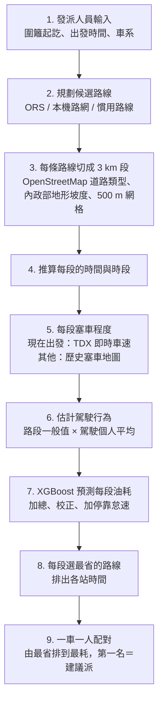
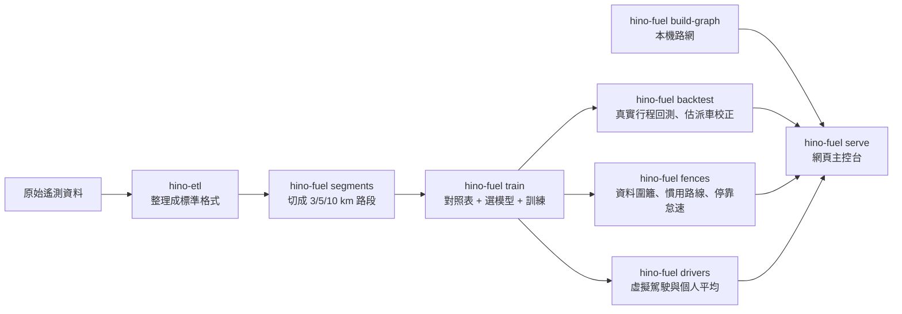

# 油耗預測系統說明：流程怎麼跑、輸入輸出、模型怎麼訓練

給第一次接觸這個系統的人看的說明。前半段（第 1–3 節）講流程怎麼跑，後半段（第 4 節起）是詳細說明。操作方式見 `docs/fuel_console_guide.md`，完整實驗紀錄見 `docs/fuel_system.md`。文中數字都是彙總統計，不含任何單筆行程或車號。

## 1. 一句話

發派人員選好圍籬起訖和車系後，系統先規劃路線，把路線切成每 3 公里一段，查出每段是什麼路、多陡、塞不塞，再估計每位駕駛會怎麼開，交給油耗模型算出每組「駕駛 × 車」的整趟油耗，最後每台車配一位駕駛，由最省排到最耗。

所有數字都由程式與 XGBoost 計算。LLM（Gemini）只負責把算好的結果寫成文字報告，不參與任何數字。

## 2. 發派時流程怎麼跑（一步一步）



### 步驟 1：發派人員輸入

* 起點、終點（可加中途停靠）都是圍籬；中途停靠可以填停留分鐘。
* 日期與出發時間，或勾「現在出發」。
* 按車系按鈕（300 / 500 / 700 系）。車系代表貨量需要多大的車，只在同車系裡比較，否則小車永遠最省。

### 步驟 2：規劃候選路線

每一段（起點 → 第一站、第一站 → 第二站…）各自找候選路線：

| 來源 | 說明 |
|---|---|
| ORS（OpenRouteService） | 大型貨車模式（driving-hgv），回傳路線座標。100 公里內最多給 3 條替代路線，超過 100 公里只給 1 條。結果存快取，同一段不重複呼叫。 |
| 車隊熟悉路線 | 用本機 OpenStreetMap 路網規劃，車隊訓練期常跑的路段成本減半，比較接近司機實際會走的路。 |
| 慣用路線 | 起訖都是「資料圍籬」且訓練期有固定走法時，直接用當時的 GPS 軌跡。 |

ORS 免費額度用完或連不上時，自動改用本機路網，畫面會出現提示。

### 步驟 3：把每條路線切成 3 公里一段，查每段的條件

沿路線每 100 公尺取一個點：

* **OpenStreetMap**：每個點找最近的道路，判斷高速 / 一般 / 市區，算出這段在高速和市區的比例，依距離多數決決定道路類型。
* **內政部 20 公尺地形資料**：查每個點的海拔，算累積爬升與淨坡度。
* **500 公尺網格**：記下經過哪些格子，之後用來查「這附近一般人怎麼開、平常塞不塞」。

### 步驟 4：推算每段的時間與時段

從出發時間開始，一段一段往前推：

* 每段時間 = 段長 ÷（卡車暢通車速 × 塞車程度）。
* 下一段的時段（早尖峰 7–9、白天 9–17、晚尖峰 17–19、夜間 19–7）用前面累積後的時間判斷。
* 到中途停靠站會加上停留時間，再出發。

### 步驟 5：判斷每段塞不塞

**塞車程度** = 車速 ÷ 卡車暢通車速。1 = 不塞，0.5 = 只開得到暢通車速的一半。

* **勾「現在出發」時，第一段用 TDX 即時路況**：
  1. 向 TDX 取國道與省道各路段的即時車速（每分鐘更新，系統快取 60 秒）。
  2. 用 TDX 的路段形狀（快取 30 天），把路線上每個點對到 40 公尺內最近的 TDX 路段。
  3. 這一段有一半以上的點對得到，就用 TDX 車速 ÷ 卡車暢通車速當塞車程度，上限 1（TDX 是全車種車速，比卡車快只代表不塞）。
* **對不到 TDX 的段（多半是市區道路）、第二段以後、或不是現在出發**：用歷史塞車地圖，也就是訓練期同道路類型、同時段的平均塞車程度，再乘上這附近網格的修正。
* 出發時間和現在差超過 30 分鐘時，就算勾了也改用歷史地圖（到那時路況已經不同）。

### 步驟 6：估計駕駛會怎麼開

任務還沒出發，駕駛行為還不存在，所以用估計值：

```
預估行為 = 路段一般值 × 這位駕駛在這種道路的個人平均
```

* **路段一般值**：同車型、同道路類型、同時段的一般人，在這附近網格的怠速、急加速、急減速、超速。
* **個人平均**：這位駕駛過去在高速、一般道路、市區各自比一般人多或少幾倍（1.20 = 多 20%）。新進駕駛紀錄少時，先參考行為最像他的資深駕駛。

### 步驟 7：模型算油耗

* 每組「駕駛 × 車」、每一段，把 15 個特徵（第 6 節）交給 XGBoost，得到這段每百公里幾公升，換算成公升後加總。
* 乘上派車校正 0.943（由訓練期真實行程估出，補償規劃路線和實際行駛的差異）。
* 有中途停靠時，加上停靠時沒熄火的怠速油耗。
* 同時給 80% 預測區間（整趟預測 × 0.67 到 × 1.80）。

### 步驟 8：每段選最省的路線，排出時間表

每一段的候選路線裡，選「所有駕駛 × 車平均油耗最低」的那條，所有組合共用同一份時間表，算出每站預計抵達、離開時間。

### 步驟 9：一車一人配對，排名

同一時間一台車只能有一位駕駛開，所以：

1. 在所有「駕駛 × 車」組合裡，先挑整趟最省的一組。
2. 這位駕駛和這台車不再使用，從剩下的人和車再挑最省的一組。
3. 重複到車用完。列數等於該車系的車數，第一名就是建議派，最後一名是最耗油的。

### 實際例子：示範任務 1（龜山工業區 → 臺中港區，09:00 出發，700 系）

| 步驟 | 結果 |
|---|---|
| 規劃路線 | 約 124.7 公里，超過 100 公里所以 ORS 只給 1 條；車隊熟悉路線若和它不同，也一起比較 |
| 切段與道路 | 約 121.5 公里高速、3.0 公里市區 |
| 時段 | 09:00 出發，大部分路段落在「白天」 |
| 塞車 | 不是現在出發，用歷史塞車地圖 |
| 比較 | 700 系 10 位駕駛 × 5 台車 = 50 組 |
| 結果 | 5 列（每台車一位駕駛），最省 31.1 L、最耗 48.4 L |

差距主要來自車：同一台車換 10 位駕駛約差 6%；同一位一般駕駛換開 5 台車，最多差約 50%（最耗那台的效率偏差 1.17、健康度 66）。這是高速路線，駕駛行為影響本來就小；市區路線駕駛之間的差距會比較明顯。

## 3. 模型是怎麼準備好的（離線，發派前做一次）



| 步驟 | 做什麼 | 產出 |
|---|---|---|
| `hino-etl` | 原始資料清理、統一欄位與時間 | `data/interim/` |
| `segments` | 每趟行程依里程切 3 / 5 / 10 公里路段，每段算油耗、道路類型、坡度、時段、四項駕駛行為、經過的網格 | 路段表 |
| `train` | 用訓練期建對照表（行為地圖、塞車地圖、暢通車速、車輛效率偏差、健康度），比較 18 個候選模型後訓練最終模型 | `models/fuel/v1/` |
| `backtest` | 拿真實行程的起訖點重跑一次發派預測，和實際油耗比較，估出派車校正與預測區間 | `dispatch_calibration.json` |
| `fences` | 用真實起訖點建資料圍籬、找慣用路線、估停靠怠速油耗 | 圍籬、慣用路線、`stop_idle.json` |
| `drivers` | 建立虛擬駕駛名單，算每人各道路的個人平均（不重新訓練模型） | `driver_profiles.json` |
| `build-graph` | 由 OpenStreetMap 建本機路網（ORS 備援、車隊熟悉路線） | `data/osm/road_graph_v1.npz` |

訓練時和發派時用同一套方法描述路線（同樣每 100 公尺取點、同樣的道路分類與坡度計算），兩邊的特徵才對得上。

---

以下為詳細說明。

## 4. 資料與切分

* 來源：主辦方提供的 20 台 HINO 卡車遙測資料（300 系 10 台、500 系 5 台、700 系 5 台），2025/1/1–2025/11/30。實際有資料的月份是 1、3、5、6（極少）、7、9、11 月。
* 資料沒有駕駛身分、載重、油價。駕駛名單是模擬的（見第 10 節）。
* 時間切分（防止用未來資料預測過去）：

| 期間 | 日期 | 有資料的月份 | 3 km 路段數 | 用途 |
|---|---|---|---:|---|
| 訓練期 | 2025-01-01 至 2025-08-31 | 1、3、5、6、7 月 | 9,817 | 建對照表、訓練模型 |
| 　其中驗證月 | 訓練期最後一個有資料的月份 | 7 月 | 2,981 | 選段長、特徵組、超參數 |
| 測試期 | 2025-09-01 起 | 9、11 月 | 4,607 | 只在最後評估一次 |

所有對照表（行為地圖、塞車地圖、效率偏差、健康度、駕駛平均）都只用訓練期計算；選模型時則再往前退，只用驗證月以前的資料。

## 5. 為什麼要切路段

油量計每次跳 0.5 公升，大約 95% 的相鄰紀錄油量不變，逐筆算油耗沒有意義。所以每趟行程依里程表切段，累積夠長的距離才算得出可靠的油耗。

* 試過 3 / 5 / 10 公里，在驗證月比較，3 公里誤差最小（發派模式整趟 MAPE：3 km 10.9%、5 km 13.7%、10 km 13.7%），採用 3 公里。
* 訓練資料：每段在里程累積到 3 公里的那筆紀錄結束；行程最後的尾段至少 3 公里才保留，否則捨棄。
* 發派路線：每 3 公里切一段，最後不足 3 公里的尾段併入前一段。
* 剔除每百公里油耗不在 2–120 公升的路段（量測異常）。

## 6. 模型輸入（每一段 15 個特徵）

「訓練時」= 用歷史路段訓練模型時填的值；「發派時」= 任務還沒出發、預測時填的值。

| 特徵 | 意思 | 單位 / 範圍 | 訓練時 | 發派時 |
|---|---|---|---|---|
| `vehicle_type` | 車型 | 300 / 500 / 700 | 車輛資料 | 任務選的車系 |
| `vehicle_efficiency_offset` | 這台車比同型車省或耗 | 1.08 = 多耗 8% | 該車排除當月的歷史值 | 該車訓練期的值 |
| `health_score` | 車況分數 | 0–100，越高越好 | 訓練期計算一次 | 同左 |
| `road_band_code` | 道路類型 | 高速 / 一般 / 市區 | GPS 軌跡對應 OpenStreetMap | 規劃路線對應 OpenStreetMap |
| `highway_share` | 這段路在高速/快速道路上的比例 | 0–1 | 同上 | 同上 |
| `city_share` | 這段路在市區道路上的比例 | 0–1 | 同上 | 同上 |
| `elevation_gain_m` | 累積爬升高度 | 公尺 | 內政部 20 m 地形資料 | 同左 |
| `avg_slope` | 淨坡度：（段尾海拔 − 段首海拔）÷ 長度 × 100 | %，正值為上坡 | 同上 | 同上 |
| `segment_km` | 段長 | 公里，約 3 | 實際里程 | 路線長度 |
| `time_band_code` | 出發時段 | 早尖峰 7–9、白天 9–17、晚尖峰 17–19、夜間 19–7 | 段的開始時間 | 依出發時間與前面各段的預估時間推算 |
| `congestion_index` | 塞車程度 = 車速 ÷ 卡車暢通車速 | 1 = 不塞，越小越塞 | 該段實際平均車速 | 歷史塞車地圖；「現在出發」時第一段改用 TDX 即時車速 |
| `idle_min_per_km` | 每公里怠速分鐘（車輛狀態為怠速的時間） | 分/公里 | 該段實際值 | 預估值（第 8 節） |
| `harsh_acc_per_km` | 每公里急加速次數（事件 6） | 次/公里 | 該段實際值 | 預估值 |
| `harsh_brake_per_km` | 每公里急減速次數（事件 7） | 次/公里 | 該段實際值 | 預估值 |
| `overspeed_share` | 行駛時間中超過速限的比例（分母只算行駛中、有速限的時間） | 0–1 | 該段實際值 | 預估值 |

補充：

* **道路類型**：沿路徑每 100 公尺取一點，找最近的 OpenStreetMap 道路，依距離多數決。motorway 算高速；trunk 只有標示 `motorroad=yes` 或速限 ≥ 80 才算高速，其餘算一般道路（台灣很多市區省道被標成 trunk）。
* **暢通車速**：每個 500 公尺網格，訓練期行駛中車速的第 85 百分位；資料少於 20 筆的網格改用速限。
* 模型不會看到車號，也不會看到駕駛是誰。

## 7. 模型輸出

| 輸出 | 意思 | 怎麼算 |
|---|---|---|
| 每段 L/100km | 這段路每百公里用幾公升 | XGBoost 直接預測（小於 0 時取 0） |
| 每段公升 | 這段用幾公升 | L/100km × 段長 ÷ 100 |
| 整趟行駛油耗 | 每段相加 | 再乘派車校正 0.943（第 9 節） |
| 停靠怠速油耗 | 中途停靠時沒熄火的油耗 | 停留小時 × 引擎未熄火比例 × 怠速油耗率（第 9 節） |
| 整趟預測油耗 | 發派畫面顯示的數字 | 行駛油耗 + 停靠怠速油耗 |
| 80% 預測區間 | 實際油耗大約落在哪個範圍 | 整趟預測 × 0.67 到 × 1.80 |
| 預計時間 | 各站預計抵達與整趟時間 | 每段 段長 ÷（暢通車速 × 塞車程度），加總後 × 0.968，再加停留時間 |

區間這麼寬，是因為它包含了「司機不一定照規劃路線開」的不確定性（見第 13 節）。

## 8. 發派時的「預估行為」怎麼來

```
預估行為 = 路段一般值 × 駕駛個人平均（該種道路）
```

* **路段一般值** = 車型 × 道路類型 × 時段的平均（資料至少 50 公里才採用，不夠就往上層退：車型 × 道路 → 道路 → 全隊）× 500 公尺網格因子。
* **網格因子** = 經過這個網格的車實際行為 ÷ 一般值，經過次數少時往 1 收縮：w = n ÷ (n + 5)。沒跑過的網格因子為 1，等於只用道路類型平均。
* **駕駛個人平均**：見第 10 節。不指定駕駛時為 1（一般人）。
* 超速比例最大限制為 1。

## 9. 模型怎麼訓練

| 項目 | 設定 | 原因 |
|---|---|---|
| 演算法 | XGBoost 迴歸（`reg:squarederror`，`hist`） | 表格資料表現好、可解釋特徵重要度 |
| 預測目標 | 每段 L/100km | 不同段長可以比較 |
| 樣本權重 | 段長（公里） | 讓誤差以公升計，長段影響較大，總和與總油耗一致 |
| 單調限制 | 四項駕駛行為設「只能讓油耗增加」 | 歷史中「超速多」常代表路況順暢，不加限制時模型會學到「激進比較省」 |
| 訓練時的行為與塞車 | 用該段實際值 | 讓模型學到真正的「行為 → 油耗」關係 |
| 車輛效率偏差 | 訓練列用「排除當月」計算的值 | 避免特徵裡直接含有這一段自己的油耗 |
| 裝置 | CPU（可設定，GPU 失敗自動退回 CPU） | 不綁定硬體 |
| 隨機種子 | 20261002 | 結果可重現 |

**選擇流程**（只用驗證月，測試期不參與）：

1. 3 種段長 × 2 組特徵（說明書 13 項 / 加上高速與市區比例的 15 項）× 3 組超參數，共 18 個模型。
2. 每個模型都用驗證月以前的資料重建所有對照表再訓練，以早停（150 回合沒進步就停）決定回合數。
3. 比較驗證月「發派模式」（行為與塞車都用預估值）的整趟 MAPE，取最小者。

**選出的模型**：3 公里、15 項特徵，`max_depth` 6、`eta` 0.03、`min_child_weight` 20、`subsample` 0.8、`colsample_bytree` 0.8、`reg_lambda` 10。驗證月最佳回合 217，最終用整個訓練期、239 回合（多 10%）重新訓練。

**80% 預測區間**：

* 模型本身：驗證月行程「實際 ÷ 預測」的第 10 與第 90 百分位，0.85–1.16。
* 發派實際使用：用訓練期 59 趟真實行程（ORS 規劃路線 vs 實際油耗）重新估，0.67–1.80，因為包含路線不確定性。

**派車校正**（訓練期 59 趟真實行程，以 leave-one-out 在幾種方式中挑誤差最小者）：

* 油耗：× 0.943。
* 時間：× 0.968。單一起訖的 `predict_trip_fuel` 另加場站時間（300 系 3.9 分、500 系 10.9 分、700 系 52.1 分）；圍籬任務的時間不加，因為停靠時間由停留分鐘另計。

**停靠怠速油耗**（訓練期資料）：

| 車型 | 停靠時引擎未熄火比例 | 怠速油耗率 |
|---|---:|---:|
| 300 系 | 46% | 1.33 L/h |
| 500 系 | 59% | 1.16 L/h |
| 700 系 | 77% | 2.33 L/h |

## 10. 駕駛：個人平均與新進駕駛

資料沒有駕駛身分，所以建立模擬名單（此為模擬資料）：40 人（300 / 500 / 700 系各 20 / 10 / 10），每人屬於一個車系；真實的每個「一台車的一天」依當天行為分給同車系的一位駕駛，一人一天只開一台車。每車系有 1 位新進駕駛，測試期才開始出車。

**個人平均**：

* 每位駕駛在高速、一般道路、市區各有四個數字（怠速、急加速、急減速、超速）。
* 每個數字 = 他實際的行為 ÷ 同樣路段、同時段的一般值（第 8 節）。1.20 = 比一般人多 20%。用比值不用次數，因為次數會受路線影響。
* 只用「當天以前」的行程，不會用到當天或未來。
* 某種道路開得少：往他自己的全路段平均收縮，w = 段數 ÷ (段數 + 20)。

**新進駕駛**：

* 沒有任何紀錄：用一般值 1。
* 有幾趟之後：找全路段平均最像他的 3 位資深駕駛（至少 10 趟），以他們的平均為主；自己的權重 w = 趟數 ÷ (趟數 + 10)，10 趟時一半一半。

**模型不需要重新訓練**：模型學的是「行為 → 油耗」，駕駛只透過預估行為影響結果。加入新駕駛時，只要累積他的行程、更新他的個人平均。

## 11. 健康度與車輛效率偏差

**健康度**（0–100，只用和油耗無關的訊號，避免用油耗預測油耗）：

| 子項 | 意思 |
|---|---|
| 冷卻水溫 | 相近引擎負載下，水溫比同型車中位數高多少 |
| DTC 與過熱 | 故障碼與過熱事件，每千公里幾次 |
| 引擎過載 | 過載事件，每百公里幾次 |
| 引擎運轉時數 | 累積時數比同型車多多少（老化程度） |
| 電瓶電壓 | 比同型車低多少 |

每項只有比同型車差才扣分：子分數 = 100 − 25 ×（超出同型車中位數的程度 ÷ 全隊離散程度），限制在 0–100，五項平均。

**車輛效率偏差**：這台車的總油耗 ÷ 同車型、同道路類型的期望油耗，資料少時往 1 收縮。1.08 代表比同型車平均多耗 8%。因為沒有駕駛身分，它可能同時包含車況與常開這台車的人的習慣。

**限制**：只有 20 台車，每台一個固定的健康度，模型很難分清「車況差所以耗油」和「這台車本來就耗油」；分數也不會隨時間更新。

## 12. 哪些特徵最重要

測試期平均 |SHAP| 佔比（模型平均每段的預測，有多少是由這個特徵推動的）：

| 特徵 | 佔比 | 特徵 | 佔比 |
|---|---:|---|---:|
| 車型 | 28.9% | 段長 | 4.3% |
| 塞車程度 | 16.0% | 健康度 | 3.4% |
| 車輛效率偏差 | 10.8% | 急減速 | 3.3% |
| 平均坡度 | 9.5% | 高速比例 | 2.7% |
| 怠速 | 8.8% | 市區比例 | 1.7% |
| 爬升高度 | 6.7% | 超速比例 | 1.7% |
|  |  | 時段 | 1.6% |
|  |  | 道路類型 | 0.5% |
|  |  | 急加速 | 0.1% |

解讀：油耗主要由「什麼車、塞不塞、多陡、這台車本身」決定；四項駕駛行為合計約 14%，其中怠速最重要。

## 13. 準不準

**測試期，行程 ≥ 10 公里，275 趟**（路線用實際 GPS 軌跡，只看模型本身）：

| 指標 | 發派模式（行為與塞車用預估） | 事後模式（實際行為與塞車） |
|---|---:|---:|
| 整趟油耗 MAPE | 11.8% | 10.0% |
| 排序正確率 | 89% | 91% |
| 80% 區間實際涵蓋 | 77% | |

* 分車型（發派模式）：300 系 9.9%、500 系 11.0%、700 系 17.6%（推測與資料中沒有的載重有關）。
* 沒跑過的路（藏起 1/5 的 5 km × 5 km 區塊，連對照表一起重算）：發派模式 18.8%、事後模式 15.2%。
* 用駕駛個人平均：11.9%，與不分駕駛的 11.8% 相同（駕駛分配是模擬的，見第 10 節）。

**真實發派情境**（只知道起訖點，路線由 ORS 規劃，測試期 60 趟）：

| 做法 | 整趟油耗 MAPE |
|---|---:|
| ORS 只給起訖點 | 26.4% |
| 加入實際中途停靠點、車隊熟悉路線、停靠怠速 | 24.1% |
| （參考）司機照規劃路線開的行程 | 15.5% |

誤差主要來自「規劃路線 ≠ 實際開的路線」（實際里程平均比規劃多約 15%），不是油耗模型本身。

## 14. 數字怎麼看

| 數字 | 怎麼解讀 |
|---|---|
| MAPE 11.8% | 每趟預測和實際平均差 11.8%（例如實際 20 L，平均誤差約 2.4 L） |
| 排序正確率 89% | 兩趟長度相近、實際油耗差 10% 以上的行程，模型有 89% 能判斷哪趟比較耗 |
| 區間涵蓋 77% | 80% 區間實際包住 77% 的行程，略窄 |
| 倍率 / 偏差 1.20 | 比一般值多 20%；0.80 = 少 20% |
| 塞車程度 0.5 | 車速只有暢通車速的一半 |
| 健康度 66 | 某些子項明顯比同型車差；100 = 每項都不比同型車差 |
| 本人權重 50% | 個人平均一半來自自己的紀錄、一半來自相似駕駛 |
| 油耗分數 75 | 剛好等於「同車、同路、同時段、一般駕駛」的應有油耗；每多用 1% 扣 1 分 |

**油耗分數**（事後評估司機，不是發派用）：分數 = 75 + (1 − 實際油耗 ÷ 應有油耗) × 100，限制在 0–100，只算 10 公里以上的行程。應有油耗 = 同車、同路線、同時段、實際塞車下，行為填一般駕駛（normal 類型）的預測，所以塞車和坡度不算在司機身上。

## 15. 已知限制

* 沒有載重資料；700 系誤差最大。
* 只有 20 台車、7 個有資料的月份；健康度與效率偏差很難完全分開。
* 駕駛身分與分配是模擬的，「選人能省多少油」目前無法用真實資料驗證；模擬重播估計約 3.6%，屬模型推算。
* 四項駕駛行為只解釋一小部分油耗，抓不到巡航速度、油門平順度等習慣。
* 本機路網（ORS 額度用完時的備援）沒有大型車限高、限重。
* 沒有班表與車輛占用狀態，假設該車系所有人與車都能出車。

## 16. 程式位置

| 內容 | 檔案 |
|---|---|
| 切路段、路徑描述（道路、坡度、網格） | `src/hino_safepilot/fuel/segments.py`、`geo.py` |
| 對照表（行為地圖、塞車地圖、駕駛類型）與特徵表 | `maps.py`、`artifacts.py` |
| 健康度、車輛效率偏差 | `vehicles.py` |
| 訓練、驗證、特徵重要度 | `model.py`、`pipeline.py`（`run_train`） |
| ORS、TDX 連線 | `routing.py` |
| 本機路網、車隊熟悉路線 | `local_router.py` |
| 發派預測（路線 → 油耗） | `fuel_predictor.py` |
| 多點任務、駕駛 × 車配對 | `tasks.py`、`drivers.py` |
| 分數與報告 | `scoring.py`、`narration.py` |
| 參數 | `config/fuel_v1.json` |
